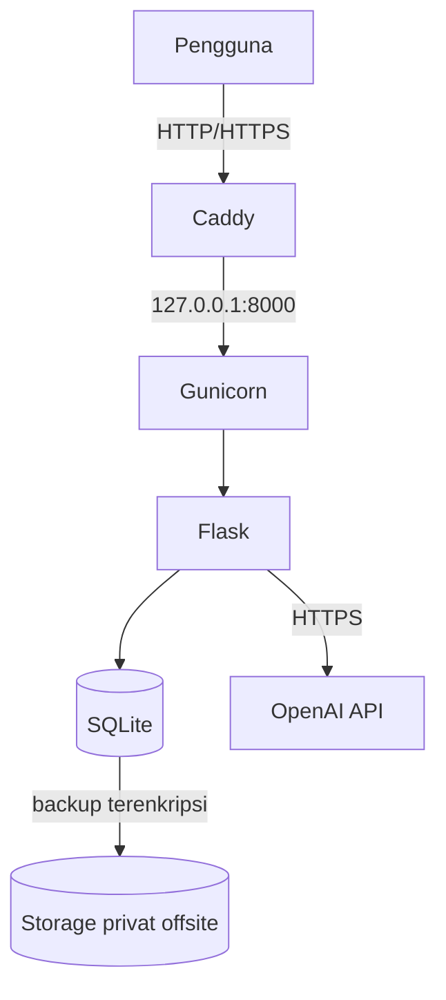

# NusanCode — Web E-Learning TIK Berbasis Kearifan Lokal

Proyek Individu Cloud Computing (PTI 2802), Institut Pendidikan Indonesia
Semester Ganjil 2026/2027 · Dosen: Muhaemin Sidiq, S.Pd., M.Pd.

**Mahasiswa:** Lailatul Zulfa · NIM 25832072001 · Kelas PTI 2A
**Judul lengkap:** Pengembangan Web E-Learning Interaktif Berbasis Kearifan Lokal dengan Pendekatan Deep Learning pada Mata Pelajaran TIK di SMA

## Masalah dan solusi
Guru TIK SMA menyusun soal dan merekap nilai secara manual, dan materi belum
dikaitkan dengan kearifan lokal. NusanCode menyediakan e-modul bertema kearifan
lokal, pengumpulan tugas, rekap nilai, dan generator kuis pilihan ganda otomatis.

## Definisi istilah
"Deep Learning" pada judul berarti **pendekatan pembelajaran mendalam
(pedagogis)**, bukan model kecerdasan buatan. Komponen AI hanya satu fitur:
generator kuis yang memanggil OpenAI API (gpt-4o-mini). Tidak ada pelatihan
model atau inferensi lokal di server.

## Pengguna dan fitur
- Peran: **guru** (kelola kelas, modul, kuis, nilai) dan **siswa** (akses modul, kerjakan kuis, kumpulkan tugas)
- Autentikasi dan pembagian hak akses per peran
- Modul pembelajaran kearifan lokal
- Pengumpulan tugas dan rekap nilai (SQLite)
- Generator kuis otomatis (OpenAI API), hasilnya ditinjau guru sebelum dipublikasikan
- Endpoint `GET /health`

## Infrastruktur (lihat `docs/evidence/ev01-vps-spec.md`)
| Komponen | Nilai |
|---|---|
| Provider / region | Microsoft Azure / Australia East |
| VM (SKU) | Standard B2ats v2 |
| Spesifikasi | 2 vCPU (burstable), 1 GB RAM, 30 GB Premium SSD |
| OS | Ubuntu Server 24.04 LTS |
| Alamat publik | belum tersedia (dijadwalkan di M04) · IPv4 `20.211.31.222` |
| Stack | Flask, Gunicorn (1 worker, 2 thread), systemd, Caddy, UFW, SQLite |

## Arsitektur

Detail: `docs/architecture.md` dan `docs/adr/`.

## Menjalankan secara lokal
```bash
git clone https://github.com/lailazulfa566-max/cc_25832072001_nusancode
cd cc_25832072001_nusancode
python3 -m venv .venv && source .venv/bin/activate
pip install -r requirements.txt
cp .env.example .env      # isi nilainya sendiri; JANGAN commit .env
flask --app app run --host 127.0.0.1 --port 5000
```

## Deployment di VM
Panduan lengkap: `docs/deployment.md`.
Backend hanya listen di `127.0.0.1:8000`; Caddy menjadi satu-satunya pintu publik.

## Keamanan dan data
- Tidak ada secret di repository. Konfigurasi memakai `.env` (di luar Git); contoh di `.env.example`.
- Data uji bersifat sintetis. Tidak ada data siswa asli.
- **Backup database tidak disimpan di repo ini.** Backup memakai SQLite `.backup`,
  dienkripsi, lalu disimpan di storage privat terpisah.
- GitHub hanya untuk kode sumber dan dokumentasi.

## Evidence dan status
| Kode | Isi | Berkas | Status |
|---|---|---|---|
| ev01 | Spesifikasi VPS | `docs/evidence/ev01-vps-spec.md` | Belum |
| ev02 | FQDN, DNS, HTTPS | `docs/evidence/ev02-https.md` | Belum |
| ev03 | Riset pengguna | `docs/evidence/ev03-riset-pengguna.md` | Belum |
| ev04 | Arsitektur dan ADR | `docs/architecture.md`, `docs/adr/` | Belum |
| ev05 | Backup | `docs/evidence/ev05-backup.md` | Belum |
| ev06 | Restore (RTO/RPO) | `docs/evidence/ev06-restore.md` | Belum |
| ev07 | TCO 12 bulan | `docs/evidence/ev07-tco-12bulan.md` | Belum |
| ev08 | Uji beban | `docs/evidence/ev08-load-test.md` | Belum |
| ev09 | Uji domain dan peran | `docs/evidence/ev09-uji-domain.md` | Belum |

## Milestone dan release
| Milestone | Tag | Status |
|---|---|---|
| M03 First deployment | `m03` | [ ] |
| M04 DNS dan HTTPS | `m04` | [ ] |
| M05 Data, backup, restore | `m05` | [ ] |

## Batasan saat ini
- Satu VM (single point of failure).
- RPO 24 jam dan RTO < 60 menit adalah **TARGET**, belum teruji kecuali tertulis di `ev06`.
- Kapasitas pengguna simultan belum terbukti kecuali tertulis di `ev08`.
- Fitur kuis AI bergantung pada layanan eksternal dan kuota token.

## Kontak
Lailatul Zulfa · lailatulzulfa@institutpendidikan.ac.id
