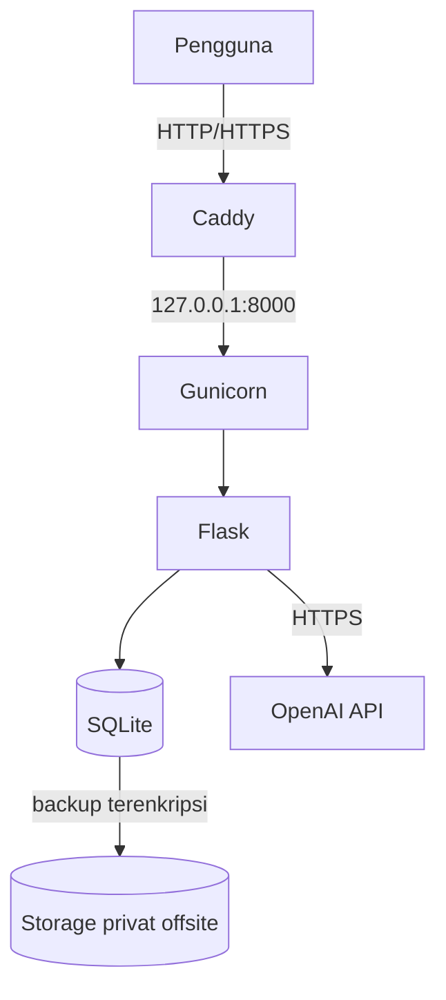

# cc_25832072001_nusancode
# NusanCode — Web E-Learning TIK Berbasis Kearifan Lokal

Proyek Individu Cloud Computing (PTI 2802), Institut Pendidikan Indonesia
Semester Ganjil 2026/2027 · Dosen: Muhaemin Sidiq, S.Pd., M.Pd.

**Mahasiswa:** Lailatul Zulfa · NIM 25832072001 · Kelas PTI 2A
**Judul lengkap:** Pengembangan Web E-Learning Interaktif Berbasis Kearifan Lokal dengan Pendekatan Deep Learning pada Mata Pelajaran TIK di SMA

## Masalah dan solusi
Guru TIK SMA menyusun soal dan merekap nilai secara manual, dan materi belum
dikaitkan dengan kearifan lokal. NusanCode menyediakan e-modul bertema kearifan
lokal, pengumpulan tugas, rekap nilai, dan generator kuis pilihan ganda otomatis.

## Definisi istilah
"Deep Learning" pada judul berarti **pendekatan pembelajaran mendalam
(pedagogis)**, bukan model kecerdasan buatan. Komponen AI hanya satu fitur:
generator kuis yang memanggil OpenAI API (gpt-4o-mini). Tidak ada pelatihan
model atau inferensi lokal di server.

## Pengguna dan fitur
- Peran: **guru** (kelola kelas, modul, kuis, nilai) dan **siswa** (akses modul, kerjakan kuis, kumpulkan tugas)
- Autentikasi dan pembagian hak akses per peran
- Modul pembelajaran kearifan lokal
- Pengumpulan tugas dan rekap nilai (SQLite)
- Generator kuis otomatis (OpenAI API), hasilnya ditinjau guru sebelum dipublikasikan
- Endpoint `GET /health`

## Infrastruktur (lihat `docs/evidence/ev01-vps-spec.md`)
| Komponen | Nilai |
|---|---|
| Provider / region | Microsoft Azure / Australia East |
| VM (SKU) | Standard B2ats v2 |
| Spesifikasi | 2 vCPU (burstable), 1 GB RAM, 30 GB Premium SSD |
| OS | Ubuntu Server 24.04 LTS |
| Alamat publik | belum tersedia (dijadwalkan di M04) · IPv4 `20.211.31.222` |
| Stack | Flask, Gunicorn (1 worker, 2 thread), systemd, Caddy, UFW, SQLite |

## Arsitektur

## Kontak
Lailatul Zulfa · lailatulzulfa@institutpendidikan.ac.id
