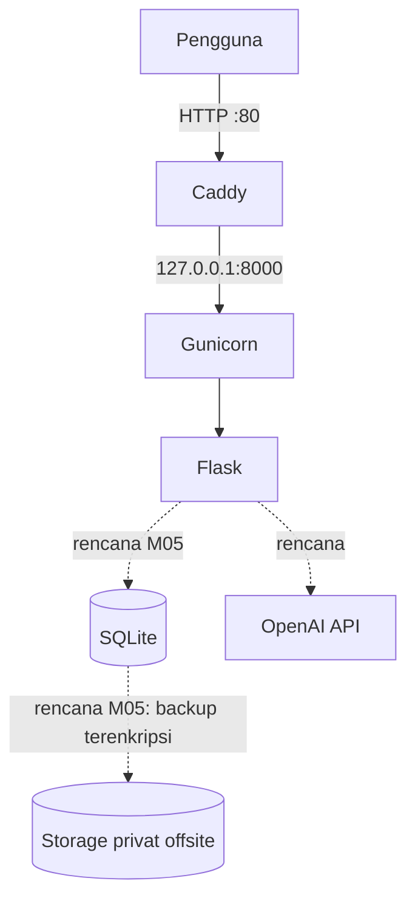

# NusanCode — Web E-Learning TIK Berbasis Kearifan Lokal

Proyek Individu Cloud Computing (PTI 2802), Institut Pendidikan Indonesia
Semester Ganjil 2026/2027 · Dosen: Muhaemin Sidiq, S.Pd., M.Pd.

**Mahasiswa:** Lailatul Zulfa · NIM 25832072001 · Kelas PTI 2A
**Judul lengkap:** Pengembangan Web E-Learning Interaktif Berbasis Kearifan Lokal dengan Pendekatan Deep Learning pada Mata Pelajaran TIK di SMA

## 1. Masalah dan solusi
Guru TIK SMA menyusun soal dan merekap nilai secara manual, dan materi belum
dikaitkan dengan kearifan lokal. NusanCode dirancang menyediakan e-modul bertema
kearifan lokal, pengumpulan tugas, rekap nilai, dan generator kuis dengan berbagai bentuk soal.

## 2. Definisi istilah
"Deep Learning" pada judul berarti **pendekatan pembelajaran mendalam
(pedagogis)**, bukan model kecerdasan buatan. Komponen AI yang direncanakan hanya
satu fitur: generator kuis yang memanggil OpenAI API (gpt-4o-mini). Tidak ada
pelatihan model atau inferensi lokal di server.

## 3. Status fitur
| Fitur | Status |
|---|---|
| Halaman utama dan endpoint `GET /health` | **Tersedia (M03)** |
| Login dengan peran guru dan siswa | Rencana |
| Kelas, modul kearifan lokal, tugas, rekap nilai (SQLite) | Rencana (M05 dst.) |
| Generator kuis OpenAI, ditinjau guru sebelum dipublikasikan | Rencana |

## 4. Infrastruktur (bukti: `docs/evidence/ev01-vps-spec.md`)
| Komponen | Nilai |
|---|---|
| Provider / region | Microsoft Azure / Australia East |
| VM (SKU) | Standard B2ats v2 |
| Spesifikasi | 2 vCPU (burstable), 1 GB RAM, 30 GB Premium SSD |
| OS | Ubuntu Server 24.04 LTS |
| Alamat | `http://20.211.31.222` (HTTP; domain dan HTTPS dijadwalkan M04) |
| Stack aktif (M03) | Flask, Gunicorn (1 worker, 2 thread), systemd, Caddy, UFW |
| Stack rencana | SQLite (M05), OpenAI API |

## 5. Arsitektur Sistem
Garis penuh sudah berjalan di M03. Garis putus-putus masih rencana.


Detail: `docs/architecture.md` dan `docs/adr/`.

## 6. Menjalankan secara lokal
```bash
git clone https://github.com/lailazulfa566-max/cc_25832072001_nusancode
cd cc_25832072001_nusancode
python3 -m venv venv && source venv/bin/activate
pip install -r requirements.txt
cp .env.example .env      # isi nilainya sendiri; JANGAN commit .env
flask --app app run --host 127.0.0.1 --port 5000
```

## 7. Deployment di VM
Panduan lengkap: `docs/deployment.md`.
Backend hanya listen di `127.0.0.1:8000`; Caddy menjadi satu-satunya pintu publik.

## 8. Keamanan dan data
Terbukti di M03 (lihat `docs/evidence/m03/`):
- Akun administrasi non-root; login root dan password SSH dinonaktifkan
- UFW aktif, hanya port 22 dan 80
- Gunicorn hanya listen di loopback; service aktif otomatis setelah reboot
- Konfigurasi rahasia memakai `.env` di luar Git (contoh di `.env.example`)

Rencana (belum dikerjakan):
- Backup database memakai SQLite `.backup`, dienkripsi, disimpan di storage privat
  terpisah (bukan di repo ini), lalu diuji restore (M05)
- Data uji bersifat sintetis; tidak ada data siswa asli
- GitHub hanya untuk kode sumber dan dokumentasi

## 9. Evidence dan status
| Kode | Isi | Berkas | Status |
|---|---|---|---|
| ev01 | Spesifikasi VPS | `docs/evidence/ev01-vps-spec.md` | Sah |
| ev02 | FQDN, DNS, HTTPS | `docs/evidence/ev02-https.md` | Belum (M04) |
| ev03 | Riset pengguna | `docs/evidence/ev03-riset-pengguna.md` | Belum |
| ev04 | Arsitektur dan ADR | `docs/architecture.md`, `docs/adr/` | Sah (M03) |
| ev05 | Backup | `docs/evidence/ev05-backup.md` | Belum (M05) |
| ev06 | Restore (RTO/RPO) | `docs/evidence/ev06-restore.md` | Belum (M05) |
| ev07 | TCO 12 bulan | `docs/evidence/ev07-tco-12bulan.md` | Belum |
| ev08 | Uji beban | `docs/evidence/ev08-load-test.md` | Belum |
| ev09 | Uji domain dan peran | `docs/evidence/ev09-uji-domain.md` | Belum |

## 10. Milestone dan release
| Milestone | Tag | Status |
|---|---|---|
| M03 First deployment | `m03` | [x] |
| M04 DNS dan HTTPS | `m04` | [ ] |
| M05 Data, backup, restore | `m05` | [ ] |

## 11. Batasan saat ini
- Satu VM (single point of failure); akses masih HTTP, belum HTTPS.
- Autentikasi SSH memakai kunci RSA bawaan Azure; kunci Ed25519 belum diterapkan.
- RPO 24 jam dan RTO < 60 menit adalah **TARGET**, belum teruji.
- Kapasitas pengguna simultan belum terbukti.
- Fitur kuis AI (rencana) bergantung pada layanan eksternal dan kuota token.

## 12. Kontak
Lailatul Zulfa · lailatulzulfa@institutpendidikan.ac.id
