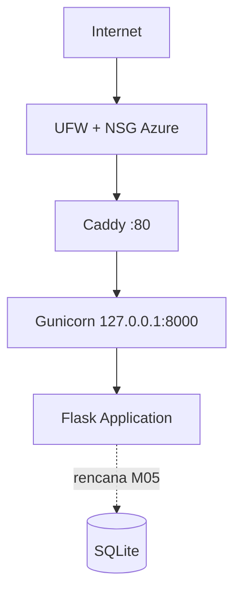

# Architecture v0.1 — NusanCode (M03)

## Deployment view
Garis penuh sudah berjalan di M03. Garis putus-putus masih rencana.

## Resource
- Azure Standard B2ats v2, Australia East
- 2 vCPU (burstable), 1 GB RAM, 30 GB Premium SSD
- Ubuntu Server 24.04 LTS

## Keputusan keamanan (terbukti di `docs/evidence/m03/`)
- Administrasi memakai akun non-root `cloudstudent`
- Login root dan password SSH dinonaktifkan; hanya `cloudstudent` yang diizinkan
- UFW aktif (22 dan 80), NSG Azure konsisten
- Backend loopback-only; Caddy satu-satunya pintu publik
- Service `cc-m03` dan `caddy` aktif otomatis setelah reboot

## Batasan saat ini
- HTTP saja (domain dan HTTPS dijadwalkan M04)
- Satu VM (single point of failure)
- Kunci SSH RSA bawaan Azure; kunci Ed25519 belum diterapkan
- Database, backup, dan restore belum dibuktikan (M05)

## Rencana
M04 DNS + HTTPS · M05 data, backup, restore · M06 container · M07 IaC · M09 CI/CD
